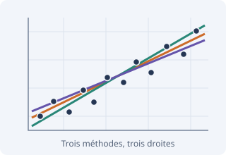
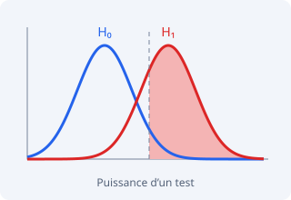

Des applications interactives pour explorer des méthodes statistiques.

```{=html}
<style>
.applet-card { display:flex; align-items:center; gap:1.5rem; padding:1.25rem; margin:1.5rem 0; border:1px solid #d7dee9; border-radius:10px; max-width:960px; }
.applet-thumbnail { flex:0 0 240px; }
.applet-thumbnail img { display:block; width:100%; border-radius:6px; }
.applet-card h2 { margin:0 0 .6rem; padding:0; border:0; font-size:1.45rem; }
.applet-card p { margin:0 0 .9rem; }
.applet-actions { display:flex; align-items:center; flex-wrap:wrap; gap:.7rem 1rem; }
@media(max-width:600px) { .applet-card { flex-direction:column; align-items:stretch; } .applet-thumbnail { flex:auto; max-width:280px; } }
</style>
<article class="applet-card">
  <a class="applet-thumbnail" href="applets/regression/index.html" aria-label="Ouvrir Trois méthodes de régression">
    
  </a>
  <div>
    <h2>Trois méthodes de régression</h2>
    <p>Comparez Mayer, médiane-médiane et moindres carrés à partir de données québécoises, de vos propres données ou de simulations. Explorez les constructions et l’effet du retrait de points.</p>
    <div class="applet-actions">
      <a class="btn btn-primary" href="applets/regression/index.html">Ouvrir l’applet</a>
      <a href="applets/regression/docs/guide-profs.html">Guide pour les enseignants</a>
    </div>
  </div>
</article>
<article class="applet-card">
  <a class="applet-thumbnail" href="applets/puissance-moyenne/index.html" aria-label="Ouvrir Puissance d’un test sur une moyenne">
    
  </a>
  <div>
    <h2>Puissance d’un test sur une moyenne</h2>
    <p>Explorez l’effet de la taille de l’échantillon, du seuil de signification, de l’écart-type et de la moyenne réelle sur la puissance. Visualisez les zones de rejet pour un test unilatéral ou bilatéral, dans le cas d’une population normale d’écart-type connu.</p>
    <div class="applet-actions">
      <a class="btn btn-primary" href="applets/puissance-moyenne/index.html">Ouvrir l’applet</a>
      <a href="applets/puissance-moyenne/guide-profs.html">Guide pour les enseignants</a>
    </div>
  </div>
</article>
```
